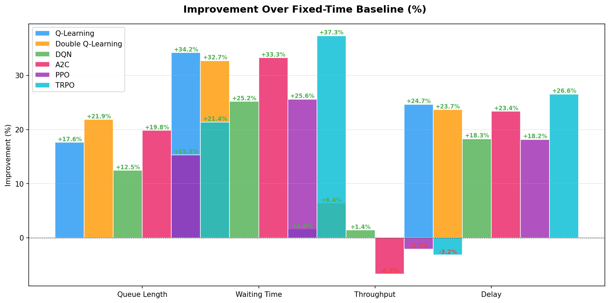

# Traffic Signal Optimization using Reinforcement Learning


Reinforcement learning agents that control the traffic signal at a four-way intersection in the SUMO traffic simulator, compared against a standard fixed-time signal.

Seven controllers are implemented and evaluated on the same traffic: a fixed-time baseline, two tabular methods (Q-Learning and Double Q-Learning), DQN, and three policy-gradient methods (A2C, PPO and TRPO).

**Headline result:** Double Q-Learning gave the best overall result. Compared with the fixed-time signal, it cut the average queue length by 22% and the average waiting time by 33%, and had the highest throughput and the best total reward.

## Results

Each agent was trained for 300 episodes and then evaluated for 3 episodes with exploration turned off. One episode is 360 decisions, 10 simulated seconds apart (one hour of traffic). The numbers below are the evaluation averages from [`results/comparison_summary.csv`](results/comparison_summary.csv).

| Agent | Avg queue (vehicles) | vs fixed-time | Avg waiting time (s) | vs fixed-time | Avg delay (s) | Throughput (vehicles) | Total reward |
|---|---|---|---|---|---|---|---|
| Fixed-time (baseline) | 14.22 | | 6.79 | | 8.92 | 188 | -1821.7 |
| **Double Q-Learning** | **11.11** | **-22%** | 4.57 | -33% | 6.81 | **200** | **-1427.5** |
| TRPO | 11.18 | -21% | **4.26** | **-37%** | **6.55** | 182 | -1571.1 |
| A2C | 11.40 | -20% | 4.53 | -33% | 6.83 | 175 | -1540.7 |
| Q-Learning | 11.71 | -18% | 4.47 | -34% | 6.72 | 191 | -1636.6 |
| PPO | 12.04 | -15% | 5.05 | -26% | 7.30 | 184 | -1625.2 |
| DQN | 12.45 | -12% | 5.08 | -25% | 7.29 | 191 | -1720.9 |

Bold marks the best value in each column. Higher reward (closer to zero) is better.

- **Double Q-Learning** had the lowest queue, the highest throughput and the best reward, so it is the best controller overall.
- **TRPO** had the lowest waiting time and delay, but a lower throughput than the fixed-time signal.
- **Every learning agent beat the fixed-time signal** on queue length, waiting time and delay.
- **Tabular Double Q-Learning beat DQN.** The state has only six values, so a binned table covers it well and learns quickly; DQN would need more training and tuning to catch up on a problem this small.



More plots are in [`results/plots/`](results/plots/): training convergence, metric comparison bars, box plots across episodes, and a time series from one evaluation episode.

## How it works

### Environment

- **Intersection:** four-way, two incoming lanes per arm, left-hand (Indian) traffic, simulated in [SUMO](https://sumo.dlr.de/) and controlled from Python through TraCI.
- **Decision step:** every 10 simulated seconds.
- **Safety rules:** a phase stays green for at least 10 seconds and at most 60 seconds, and every switch goes through a 4-second yellow phase.

### State (6 values)

| # | Value |
|---|---|
| 1 | Halted vehicles on the North-South arms |
| 2 | Halted vehicles on the East-West arms |
| 3 | Total waiting time on the North-South arms |
| 4 | Total waiting time on the East-West arms |
| 5 | Current signal phase |
| 6 | Time spent in the current phase |

The tabular agents group these values into bins (for example light, moderate or heavy queues) so the Q-table stays small. The neural network agents use the six values directly.

### Actions (5)

| Action | Meaning |
|---|---|
| 0 | Keep the current phase |
| 1 | Switch to North-South straight and right |
| 2 | Switch to North-South left |
| 3 | Switch to East-West straight and right |
| 4 | Switch to East-West left |

### Reward

```
reward = -(0.8 x increase in waiting time + 0.2 x queue length + 2.0 x phase switch) + 1.0 x throughput
```

Waiting time is what drivers feel, so its increase is penalised most. A long queue that is moving is acceptable, so queue length is penalised lightly. Switching is penalised heavily so the signal does not flicker between phases. Vehicles that clear the intersection are rewarded.

### Agents

| Agent | Type | Key settings |
|---|---|---|
| Fixed-time | Baseline | 30-second green per phase |
| Q-Learning | Tabular | learning rate 0.1, discount 0.95, epsilon 1.0 decaying by 0.995 per episode to 0.01 |
| Double Q-Learning | Tabular, two Q-tables to reduce overestimation | same as Q-Learning |
| DQN | Value-based, neural network | 2 hidden layers of 64, learning rate 0.001, replay buffer 50,000, batch 64, target network updated every 500 steps |
| A2C | Policy gradient, actor-critic | learning rate 0.001, entropy bonus 0.01 |
| PPO | Policy gradient, clipped updates | learning rate 0.0003, clip 0.2, 4 epochs per update |
| TRPO | Policy gradient, trust region | learning rate 0.001, target KL 0.01 |

All agents use a discount factor of 0.95.

## Setup

1. Install SUMO from the [official guide](https://sumo.dlr.de/docs/Installing/index.html) and set the `SUMO_HOME` environment variable to the install folder (for example `C:\Program Files (x86)\Eclipse\Sumo` on Windows).
2. Install the Python packages:

   ```bash
   pip install numpy matplotlib torch traci sumolib
   ```

3. Generate the network and traffic routes (the `data/` folder already contains a generated set):

   ```bash
   python utils/generate_sumo_files.py
   ```

## Usage

### Reproduce the full comparison

```bash
python run_final_300.py
```

This trains all seven agents for 300 episodes, evaluates each for 3 episodes, saves the models to `models/` and the metrics to `results/`, and then calls `compare.py` to write `results/comparison_summary.csv` and the plots in `results/plots/`.

To rebuild the comparison from saved results without retraining:

```bash
python compare.py
```

### Train or evaluate a single agent

`train.py` and `evaluate.py` are quick single-agent scripts for the tabular agents and the baseline:

```bash
python train.py --agent double_q --episodes 100
python evaluate.py --agent double_q --episodes 5
```

Supported agents: `q_learning`, `double_q`, `fixed_time`. Add `--gui` to watch the simulation in SUMO-GUI. Use `run_final_300.py` for DQN, A2C, PPO and TRPO.

## Project structure

```
agent/
  fixed_time_agent.py    fixed-time baseline
  q_agent.py             Q-Learning
  double_q_agent.py      Double Q-Learning
  dqn_agent.py           Deep Q-Network
  a2c_agent.py           Advantage Actor-Critic
  ppo_agent.py           Proximal Policy Optimization
  trpo_agent.py          Trust Region Policy Optimization
env/
  sumo_env.py            SUMO environment: reset, step, yellow phases
  traffic_mdp.py         state, actions and reward definition
utils/
  generate_sumo_files.py builds the network and routes
data/                    SUMO network, routes and config
models/                  trained models
results/                 training and evaluation metrics, comparison_summary.csv
results/plots/           comparison plots
run_final_300.py         full training and evaluation pipeline
train.py, evaluate.py    single-agent scripts
compare.py               comparison table and plots
generate_report_plots.py per-agent training plots
```

## References

- SUMO documentation: https://sumo.dlr.de/
- Mnih et al., 2015, [Human-level control through deep reinforcement learning](https://www.nature.com/articles/nature14236) (DQN)
- Sutton and Barto, 2018, *Reinforcement Learning: An Introduction*
- Abdulhai et al., 2003, [Reinforcement learning for true adaptive traffic signal control](https://ieeexplore.ieee.org/document/1196809)

## Author

**Sarvan Kumar** · GitHub: [@Sarvan-k03](https://github.com/Sarvan-k03)
